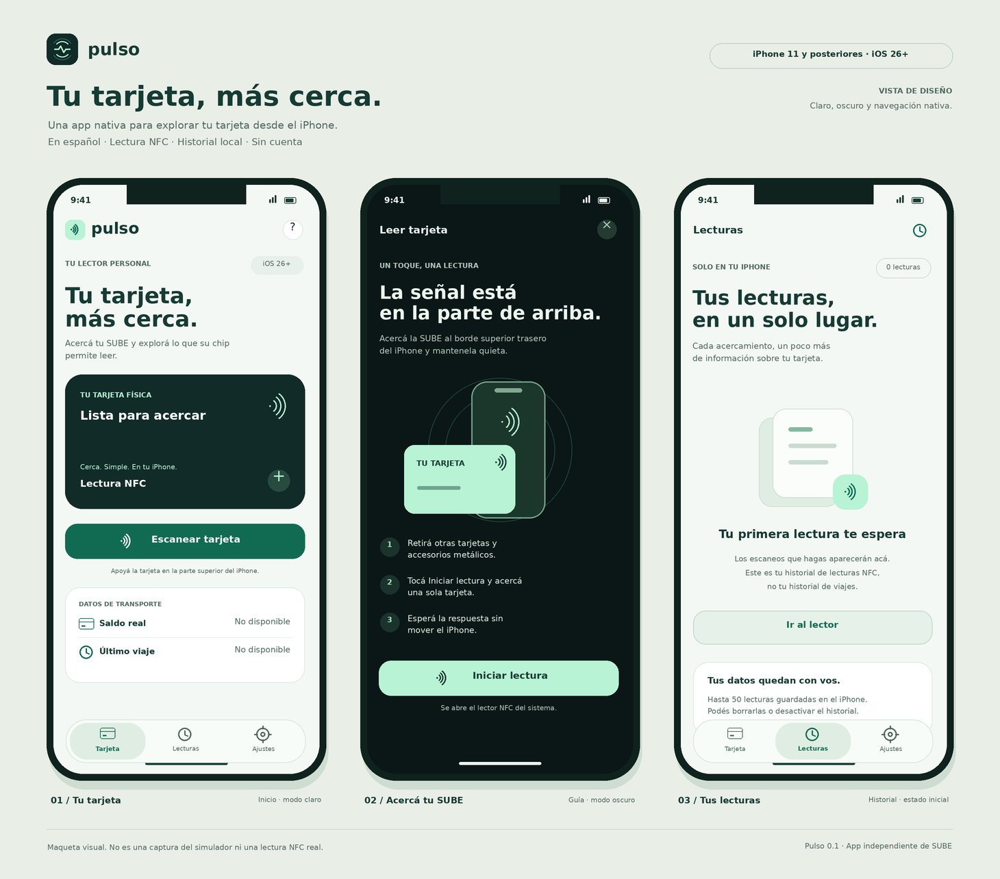

# Pulso

**Lector NFC nativo para iPhone, con iOS 26.0 como versión mínima.** Creado para probar qué información pública puede obtener el iPhone de tu tarjeta SUBE, con una interfaz en español y sin autenticación.

El proyecto usa Swift 6, SwiftUI y Core NFC. No requiere backend ni dependencias de terceros para compilar la app.

[](https://github.com/AnnonyA/Pulso/actions/workflows/ios.yml)

**Primera compilación confirmada:** [ejecución #1, completada correctamente](https://github.com/AnnonyA/Pulso/actions/runs/45969338666). [Descargar el artifact con `Pulso-unsigned.ipa`](https://github.com/AnnonyA/Pulso/actions/runs/45969338666/artifacts/15184396513). GitHub requiere iniciar sesión para descargar artifacts y los conserva durante el plazo configurado.



La imagen es una **maqueta de diseño**, no una captura del simulador ni una lectura real. El código de la aplicación es SwiftUI nativo. También se incluye una vista de diseño en `docs/design/design-preview.html` para abrir en el navegador.

## Generar el `.ipa` desde Windows 10

La vía principal es **GitHub Actions**: GitHub ejecuta Xcode en una máquina macOS y entrega el archivo descargable. No necesitás tener una Mac.

1. Extraé el ZIP del proyecto.
2. Subí **el contenido de esta carpeta** a la raíz de un repositorio de GitHub. Deben quedar `Pulso.xcodeproj`, `Sources`, `Config` y `.github` en la raíz; no subas el ZIP como un único archivo.
3. Abrí **Actions → Compilar IPA - iOS 26 → Run workflow**. También se ejecuta cuando subís cambios de la app a `main` o `master`.
4. Cuando termine correctamente, abrí **Artifacts → Pulso-iOS26-unsigned-…**.
5. Extraé el ZIP del artifact. Ahí estará **`Pulso-unsigned.ipa`**.

La guía [docs/BUILD.md](docs/BUILD.md) explica GitHub Desktop, el ayudante de PowerShell, compilación, firma, diagnósticos y resolución de errores.

### Ayudante de PowerShell

Con Git y GitHub CLI instalados, abrí PowerShell dentro de la carpeta extraída y ejecutá:

```powershell
powershell -NoProfile -ExecutionPolicy Bypass -File .\scripts\build-from-windows.ps1 -RepositoryName pulso-ios
```

El script inicia sesión con GitHub si hace falta, crea un **repositorio privado nuevo**, sube el proyecto, espera la compilación y descarga el artifact. Rechaza repositorios existentes para no tocar otro proyecto tuyo. Necesita que tu nombre y correo de autor estén configurados en Git. No sube certificados ni solicita credenciales de Apple.

## Qué incluye

- Inicio y guía para acercar una sola tarjeta a la parte superior del iPhone.
- Sesión NFC real mediante `NFCTagReaderSession`, con manejo de cancelación, espera agotada, varias tarjetas y errores.
- Datos públicos que iOS exponga: tecnología, familia MIFARE, identificador del chip y metadatos disponibles.
- Resultado con estado claro y exportación de diagnóstico.
- Historial local opcional de hasta 50 lecturas, con eliminación.
- Ajustes, privacidad, ayuda, tema claro/oscuro y accesibilidad.
- Ícono propio y configuración de NFC, privacidad y despliegue.
- Compilación automatizada, pruebas del modelo y validación del binario IPA.

## Alcance de esta versión

**Detectar MIFARE Plus no confirma que una tarjeta sea SUBE.** El UID del chip tampoco equivale al número impreso de la tarjeta.

Saldo y último viaje aparecen como **no disponibles**: esta versión no autentica sectores ni interpreta datos protegidos, y no inventa valores. No acredita cargas, no escribe en la tarjeta y no emula una SUBE. Determinadas generaciones o modos de tarjetas SUBE pueden no ser detectables con Core NFC.

Pulso es un proyecto independiente; no es la app oficial de SUBE ni está afiliado a Nación Servicios.

## Firma y NFC

El flujo entrega un **IPA sin firmar**. Para instalarlo, tu método de firma debe usar una identidad y un perfil válidos que permitan **Near Field Communication Tag Reading** y conserven `com.apple.developer.nfc.readersession.formats = ["TAG"]`.

El artifact incluye el archivo de entitlements como referencia; ese archivo no concede permisos por sí mismo. Que una herramienta consiga instalar la app no garantiza que conserve la capacidad NFC. No se necesitan las autorizaciones especiales de emulación de tarjetas de NFC & SE para este lector.

## Estructura

```text
Pulso.xcodeproj/          Proyecto de Xcode y esquema compartido
Sources/Pulso/           App, interfaz, modelo, NFC y recursos
Config/                  Info.plist y entitlements
Tests/PulsoDomainTests/   Pruebas del modelo sin hardware
.github/workflows/       Compilación de iPhone en macOS
scripts/                 Ayudantes y validadores
docs/BUILD.md            Guía para Windows y firma
```

## Estado de validación

El 27 de noviembre de 2026, GitHub Actions compiló correctamente la app con **Xcode 26.6 / SDK iOS 26.5**, ejecutó las **7 pruebas del modelo** y generó el IPA. El verificador confirmó un ejecutable Mach-O `arm64` para **iPhoneOS**, mínimo exacto **26.0**, íconos y manifiesto de privacidad. La descarga se verificó además mediante SHA-256.

**Pendiente:** instalación, ejecución de la interfaz y prueba física de NFC con tu tarjeta en el iPhone 11. La compilación correcta no garantiza que Core NFC pueda detectar una SUBE de cualquier generación. El registro completo y los límites están en [docs/VALIDATION.md](docs/VALIDATION.md).

## Referencias

- [Core NFC: NFCTagReaderSession](https://developer.apple.com/documentation/corenfc/nfctagreadersession)
- [Entitlement de lectura NFC](https://developer.apple.com/documentation/bundleresources/entitlements/com.apple.developer.nfc.readersession.formats)
- [Capacidades y perfiles iOS](https://developer.apple.com/help/account/reference/supported-capabilities-ios)
- [Ejecutores hospedados de GitHub](https://docs.github.com/en/actions/reference/runners/github-hosted-runners)
- [Software del runner macOS 26](https://github.com/actions/runner-images/blob/main/images/macos/macos-26-arm64-Readme.md)
